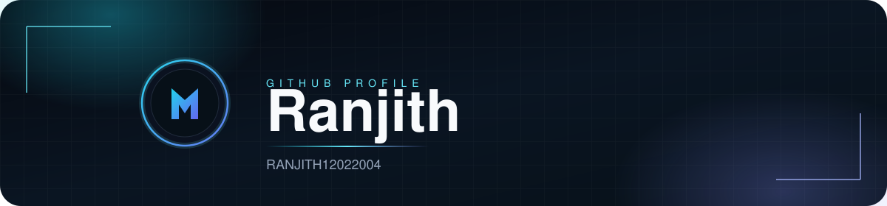
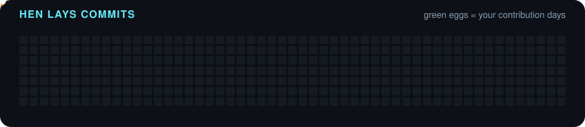

<h2 align="center">About</h2>

Builder of the <strong>Marc</strong> stack — a Cursor-like Windows IDE, workers, assistants, and terminals that plan and ship code.

<table>
  <tr>
    <td align="center" width="25%">
      <a href="https://github.com/RANJITH12022004/Marc-super-compute"><strong>Marc</strong></a> 
      Cursor-like Windows IDE · Tauri · Monaco · Meta Muse
    </td>
    <td align="center" width="25%">
      <a href="https://github.com/RANJITH12022004/Marc_phase1"><strong>Marc phase 1</strong></a> 
      Java foundation for the Marc editor
    </td>
    <td align="center" width="25%">
      <a href="https://github.com/RANJITH12022004/marc-workers"><strong>marc-workers</strong></a> 
      Cursor plans · Meta Muse · Bee island
    </td>
    <td align="center" width="25%">
      <a href="https://github.com/RANJITH12022004/marc-assistant"><strong>marc-assistant</strong></a> 
      Python assistant for Marc workflows
    </td>
  </tr>
</table>

  Also shipping <a href="https://github.com/RANJITH12022004/RXTerm-Windows"><strong>RXTerm-Windows</strong></a> — AI terminal with NL→command, error whisperer, live dashboard, and session replay.

<h2>Featured work</h2>

<h2>GitHub</h2>

<table>
  <tr>
    <td align="center" width="50%">
      
    </td>
    <td align="center" width="50%">
      
    </td>
  </tr>
</table>

 

 

 

<h2>Languages &amp; tools</h2>

<strong>Marc stack</strong>

  

<strong>Languages</strong>

  

<strong>Frontend</strong>

  

<strong>Backend &amp; data</strong>

  

<strong>DevOps &amp; tools</strong>

  

<h2>Connect</h2>

  
  
  

<h3>Hen laying commits</h3>

  

 

